# CTF Write-up: Operation Cymbal Cold Room

This is my write-up for the Google SecOps CTF "Operation Cymbal Cold Room". It has three challenges:

1. [Deceptive Click](#1-deceptive-click)
2. [OAuth Heist](#2-oauth-heist)
3. [Rogue Synthesis](#3-rogue-synthesis)

For each question, I explain what we need to find, the query I used in Google SecOps (SIEM search), and the flag.

---

## 1. Deceptive Click

**Scenario:** You work in the Security Operations Center (SOC) of Cymbal Investments. A high-priority case called "PowerShell Download And Execute" is in your queue. Curated Detections found suspicious activity on a computer in the Denver office. Using Google SecOps (SIEM search, Gemini, and Google Threat Intelligence), your job is to find how the attacker got in and what they wanted, before important company systems are compromised.

### Q1. What is the hostname of the compromised endpoint in the Denver office?

*Expected format: `FAKE-HOST-NAME-000.false.name`*

We need the hostname of the infected computer in Denver.

I searched for the "PowerShell Download" case. Gemini showed a summary of the case automatically. The summary listed a host that was confirmed as malicious. That host is the flag.

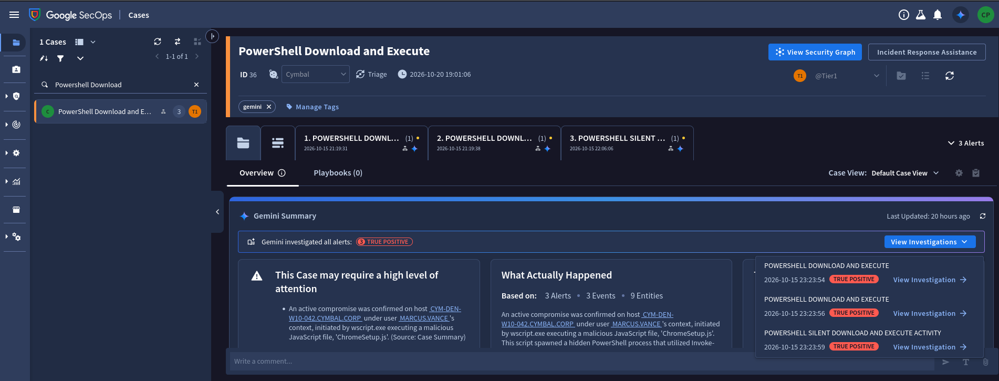

**Flag 1:** `CYM-DEN-W10-042.cymbal.corp`

### Q2. What is the domain of the compromised blog that was the referer for the malicious update archive?

*Expected format: `domainname.com`*

The GTI Malware Profile says FAKEUPDATES is delivered through hacked third-party websites that inject malicious JavaScript. So we need the domain of the hacked blog. I moved to Investigation > SIEM Search.

Query:

```
target.url = /ChromeSetup_v124\.zip/ nocase
```

This query finds the request that downloaded the fake update archive. In the event viewer, the **referral URL** shows the hacked domain. That domain is the flag.

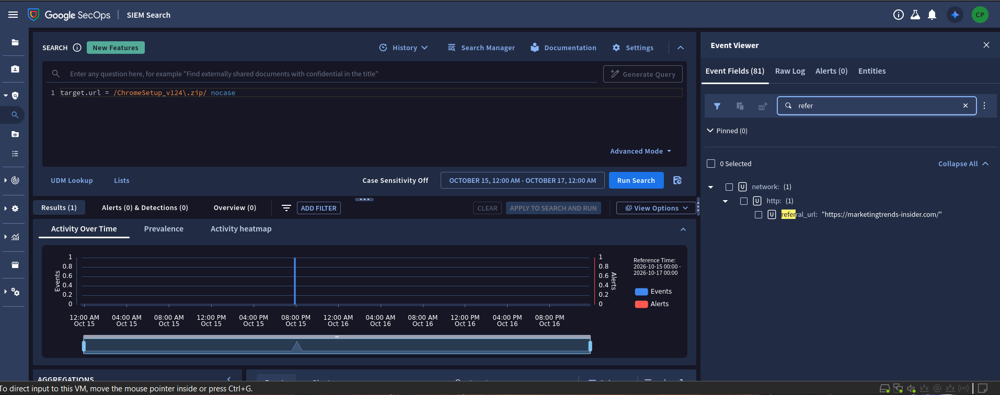

**Flag 2:** `marketingtrends-insider.com`

### Q3. What was the Target Process ID of the svchost.exe instance that d27e15eb.exe injected into?

*Expected format: `000`*

The second payload `d27e15eb.exe` got SYSTEM rights by hollowing (injecting into) a SYSTEM process. We need the PID of that `svchost.exe`.

Query:

```
principal.hostname = /CYM-DEN-W10-042/ nocase AND principal.process.file.full_path = /d27.15eb/ nocase
```

This returns 1 event. The log shows 4 PIDs. The answer format has only 3 digits, so I picked the PID with 3 digits: `624`.

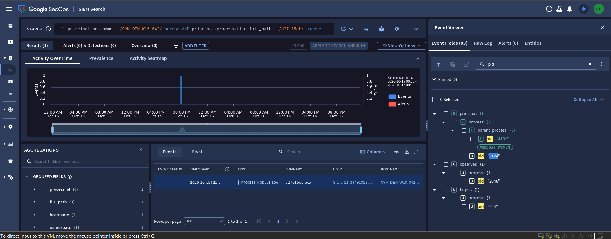

**Flag 3:** `624`

### Q4. What is the full Service Principal Name (SPN) requested in the Kerberos TGS ticket?

*Expected format: `XXXXXXX/FAKE-HOST-NAME-00.false.name:0000`*

After domain recon, the attacker did **Kerberoasting** against the Domain Controller (`CYM-DC-01`).

Kerberoasting means asking for Kerberos service tickets (TGS) for service accounts, then cracking those tickets offline to get the account password. A TGS request is logged on the domain controller as **Windows Event ID 4769**.

First query:

```
principal.hostname = /CYM-DC-01/ nocase AND metadata.product_event_type = "4769"
```

This returned 0 events. So I tried a wider query:

```
metadata.product_event_type = "4769"
```

This returned 78 events. Checking them one by one takes too long, so I made the query more specific:

```
metadata.product_event_type = "4769" AND (principal.hostname = /CYM/ nocase OR target.hostname = /CYM/ nocase OR principal.user.userid = /marcus/ nocase OR target.user.userid = /marcus/ nocase)
```

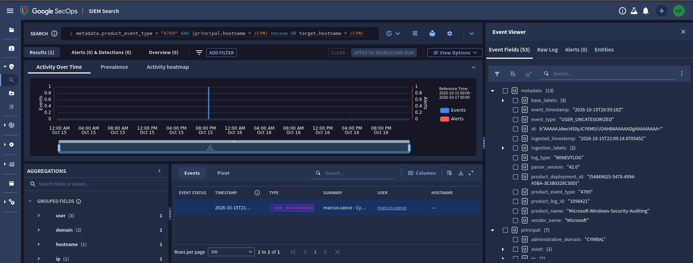

I opened the **Raw Log** to see all details. It has a `ServiceName` field. That value is the flag.

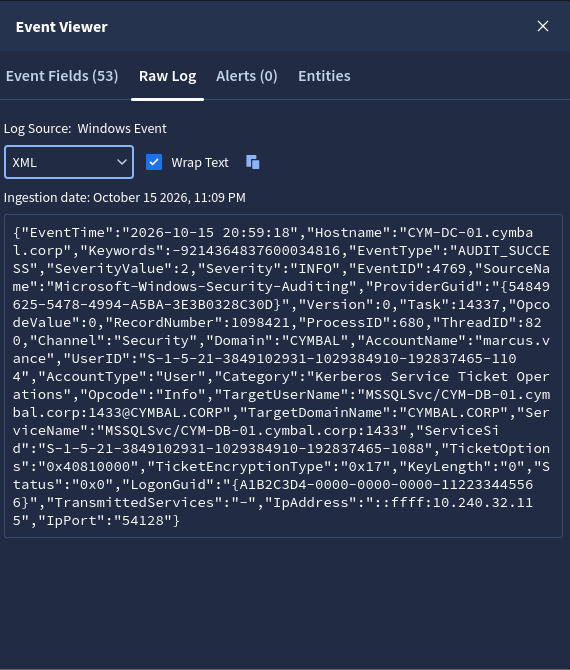

**Flag 4:** `MSSQLSvc/CYM-DB-01.cymbal.corp:1433`

### Q5. What username was used for lateral movement after the attacker switched identities?

*Expected format: `username`*

After cracking the service account password, the attacker used it to log in to other servers from the victim's computer. So we look for logins coming from the Denver computer's IP.

Query:

```
metadata.event_type = "USER_LOGIN" AND (principal.ip = "10.240.32.115" OR src.ip = "10.240.32.115")
```

This returns 2 events, with the users `marcus.vence` and `svc_backup`:

- `marcus.vence` is the victim's normal login, before Kerberoasting.
- `svc_backup` is a network login (NtLmSsp) that happened **after** Kerberoasting.

So the answer is `svc_backup`.

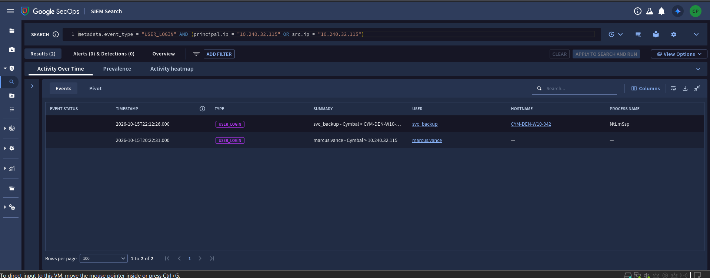

**Flag 5:** `svc_backup`

### Q6. What is the name of the zip archive the attacker created on the file server to stage financial audit files?

*Expected format: `File_Name.extension`*

After getting into `CYM-FS-01`, the attacker's next step is to collect and pack the data before stealing it.

First, confirm the login:

```
metadata.event_type = "USER_LOGIN" AND target.user.userid = "svc_backup"
```

Only 1 log appears. It shows `svc_backup` logged in over the network (LogonType 3, NTLM) from the Denver computer (`CYM-DEN-W10-042`, IP `10.240.32.115`).

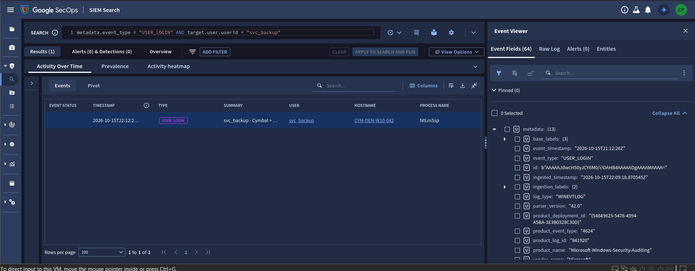

Then search for zip files on the file server:

```
principal.hostname = /CYM-FS-01/ nocase AND target.file.full_path = /\.zip/ nocase
```

This returns 1 log. The user is `svc_backup` and it shows a newly created file. This is the file that was going to be stolen, and it is the flag.

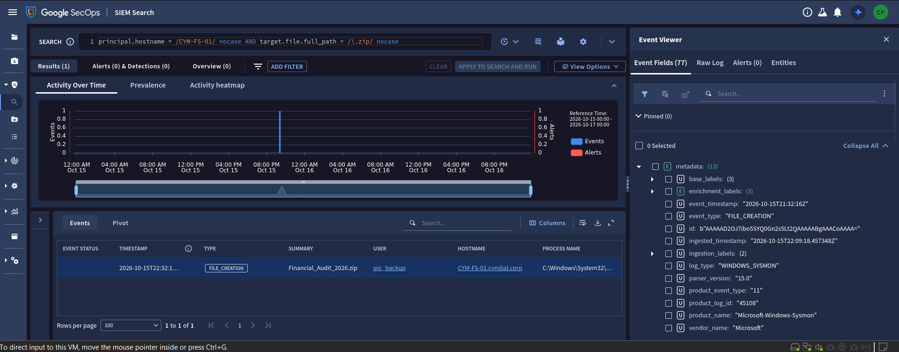

**Flag 6:** `Financial_Audit_2025.zip`

---

## 2. OAuth Heist

**Scenario:** A high-priority threat bulletin from Google Threat Intelligence about **SHINYHUNTERS** appears in Emerging Threats. Using Google SecOps (SIEM search, Curated Detections, and GTI reports), your job is to investigate the first identity compromise and find the full scope of the incident.

### Q1. What is the phishing domain where employee credentials were sent with an HTTP POST request?

*Expected format: `domainname.com`*

We need to find the phishing domain.

First query:

```
metadata.event_type = "NETWORK_HTTP" AND network.http.method = "POST"
```

This gives only 2 detections. The Aggregations panel on the side shows 2 domains, but neither of them is the answer.

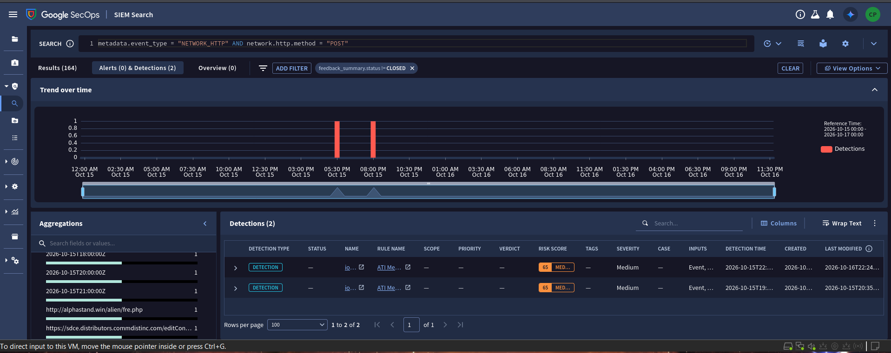

So I made a more specific query that looks for login-style hostnames:

```
metadata.event_type = "NETWORK_HTTP" AND network.http.method = "POST" AND target.hostname = /signin|login|sso|okta|auth|verify|mfa/ nocase
```

This gives 10 events. The trick is to look at the **summary**. Almost every row says "to Demoverse", which means the domain belongs to the organization. Only one domain is different and points to an SSO page. That one is the flag.

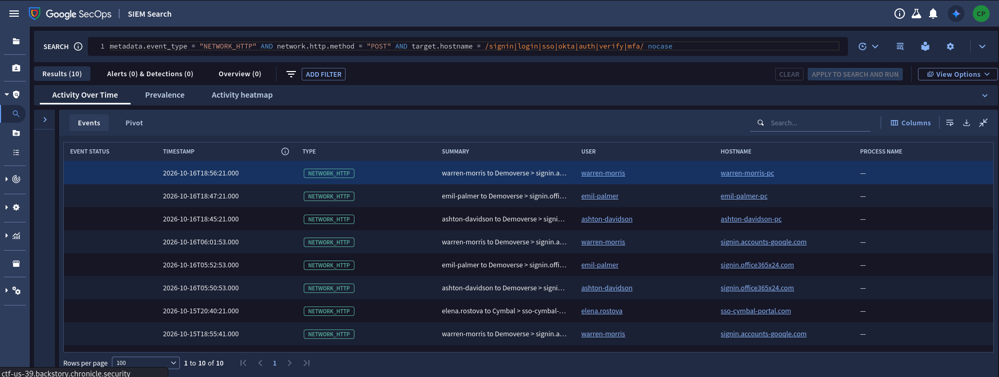

**Flag 1:** `sso-cymbal-portal.com`

### Q2. What is the exact subject line of the first permanently deleted email about MFA changes?

*Expected format: `Hello! This is a fake email subject line`*

To stop the victim from noticing, the attacker used a newly approved third-party OAuth app to permanently delete security alerts from the victim's inbox. We need the subject of the first deleted MFA email.

From the earlier step we know the victim's name is **elena**. So I searched OAuth/token events for her:

```
metadata.product_event_type = /authorize|oauth|token|grant/ nocase AND (principal.user.email_addresses = /elena/ nocase OR target.user.email_addresses = /elena/ nocase OR principal.user.userid = /elena/ nocase)
```

An event with type `EMAIL_TRANSACTION` appears. Its summary talks about a new MFA factor being added. That subject is the flag.

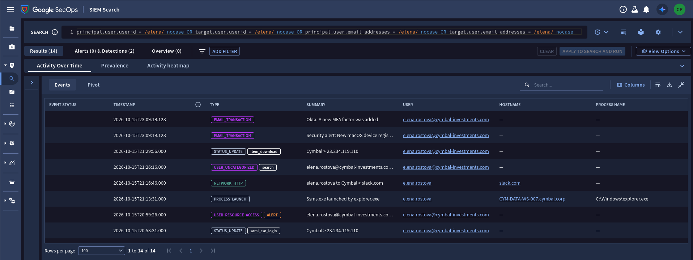

**Flag 2:** `Okta: A new MFA factor was added`

### Q3. What sensitive internal document did the attacker find and download?

*Expected format: `File_Name.extension`*

We need the file the attacker downloaded from the cloud through their proxy.

I used the same query as Q2. Among all of elena's events, we must separate her own activity from the attacker's activity. One event is an **item download**. I opened that log and found the flag.

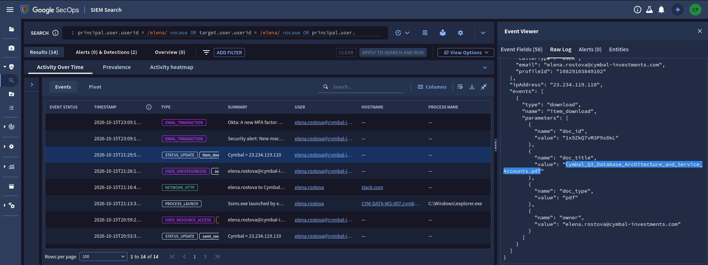

**Flag 3:** `Cymbal_Q3_Database_Architecture_and_Service_Accounts.pdf`

### Q4. What privileged service account did the attacker use from the victim's workstation to access the database server?

*Expected format: `username`*

There is a trap here. If you search for elena, you will not find this login, because the attacker used a different account name.

The fix is to **pivot from the user to the host/IP**:

```
metadata.event_type = "USER_LOGIN" AND (principal.ip = "10.240.12.65" OR src.ip = "10.240.12.65" OR principal.hostname = /CYM-DATA-WS-007/ nocase)
```

The result shows the user that logged in. That user is the flag.

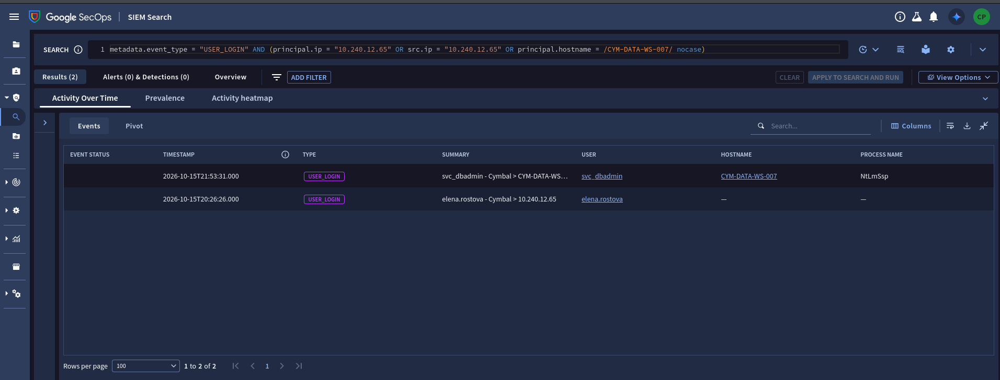

**Flag 4:** `svc_dbadmin`

### Q5. What is the name of the raw database dump the attacker exported before compressing it?

*Expected format: `file_name.extension`*

I pivoted to all activity by `svc_dbadmin`:

```
principal.user.userid = /svc_dbadmin/ nocase OR target.user.userid = /svc_dbadmin/ nocase
```

This returns 8 events, all on server `CYM-DB-01`. The order of the events tells the story:

1. `wsmprovhost.exe`: the attacker gets in with PowerShell Remoting.
2. `sqlcmd.exe`: the database is dumped.
3. `zstd.exe`: the dump is compressed.
4. Outbound network connection: the data is exfiltrated.

One of the events shows a backup file. That file is the flag.

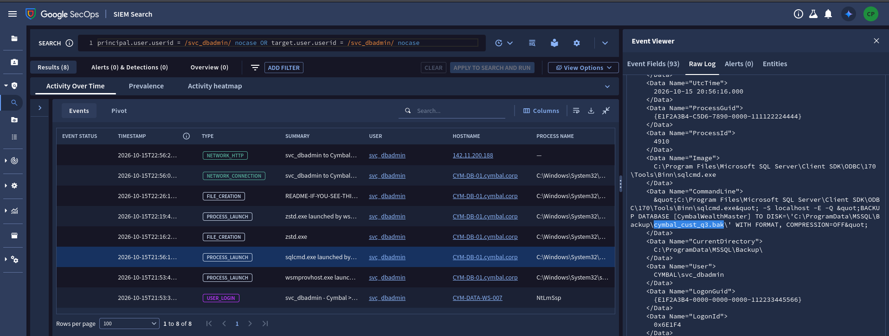

**Flag 5:** `cymbal_cust_q3.bak`

### Q6. What is the full exfiltration URL (with IP and port) used to send the compressed archive?

*Expected format: `http://8.8.8.8:0000/path/file_name.extensions`*

We need the full URL: IP, port, path, and file name. Each log only gives part of it, so we combine three logs. I used the same query as Q5.

**Step 1:** The `zstd.exe` event (Sysmon Event ID 1) shows a `.zst` file. Write down this file name.

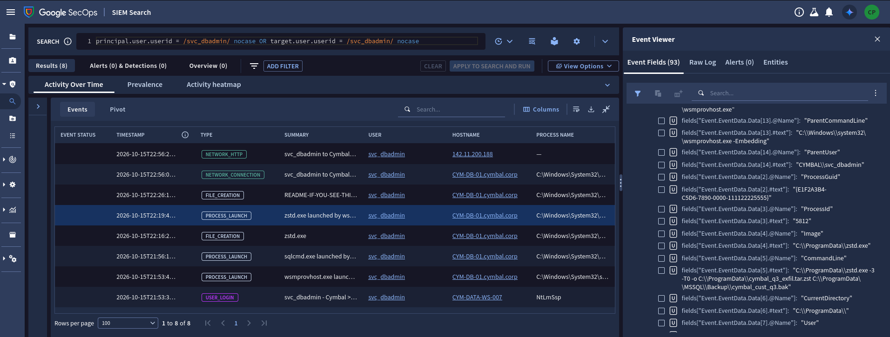

**Step 2:** The network connection event shows the IP address and port. Now we have the IP, port, and file name, but we still need the path.

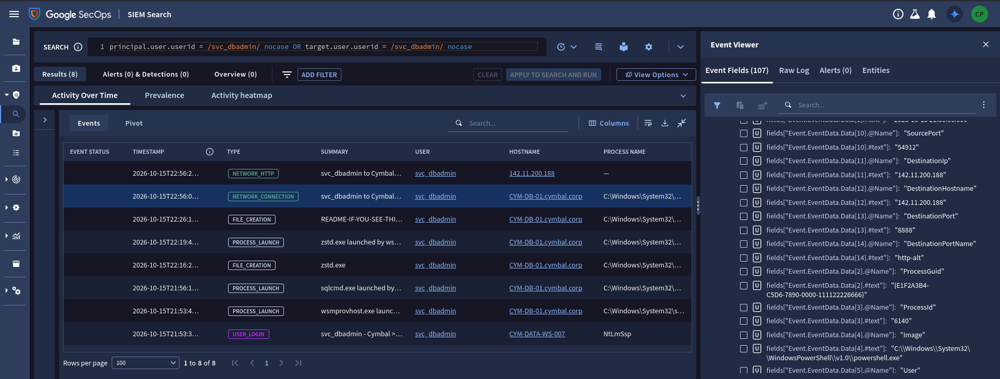

**Step 3:** The Zscaler proxy event (`NETWORK_HTTP`) has the full URL with IP, port, path, and the `.zst` file. That is the flag.

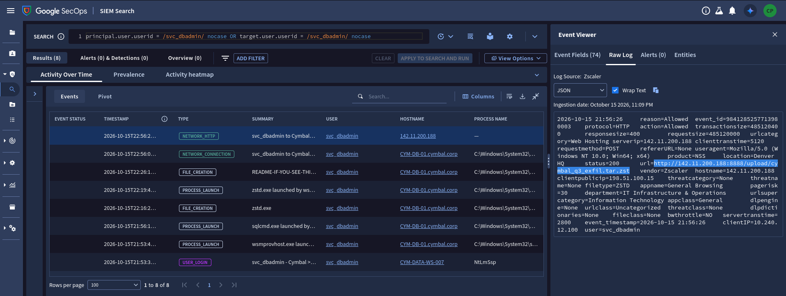

**Flag 6:** `http://142.11.200.188:8888/upload/cymbal_q3_exfil.tar.zst`

---

## 3. Rogue Synthesis

**Scenario:** The Cymbal Investments Threat Hunting team got an intelligence bulletin about AI threats. Using Google Threat Intelligence (GTI) reports and Google SecOps SIEM, your job is to find the first compromise and the attacker's final target in the CI/CD pipeline.

### Q1. What developer username sent a request to the model used by the AI threat?

*Expected format: `user.name`*

We need to check HTTP traffic to AI model endpoints:

```
metadata.event_type = "NETWORK_HTTP" AND
(target.hostname = /huggingface\.co/ nocase OR target.url = /huggingface|generativelanguage|qwen|gemini/ nocase)
```

Three users sent requests. The answer is the one at the top: `alex.chen`.

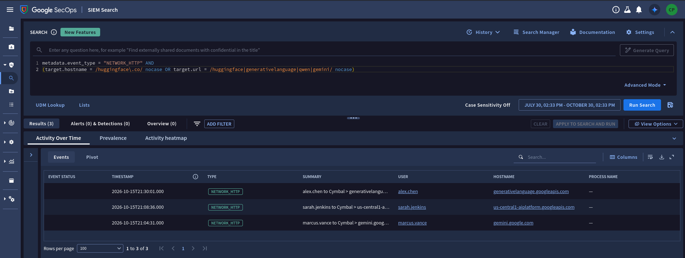

**Flag 1:** `alex.chen`

### Q2. What package was downloaded right before the API query?

*Expected format: `File_Name.extension`*

First query:

```
principal.user.userid = "alex.chen" OR target.user.userid = "alex.chen"
```

This returns 25 logs. Checking each one takes too long, so I made it more specific.

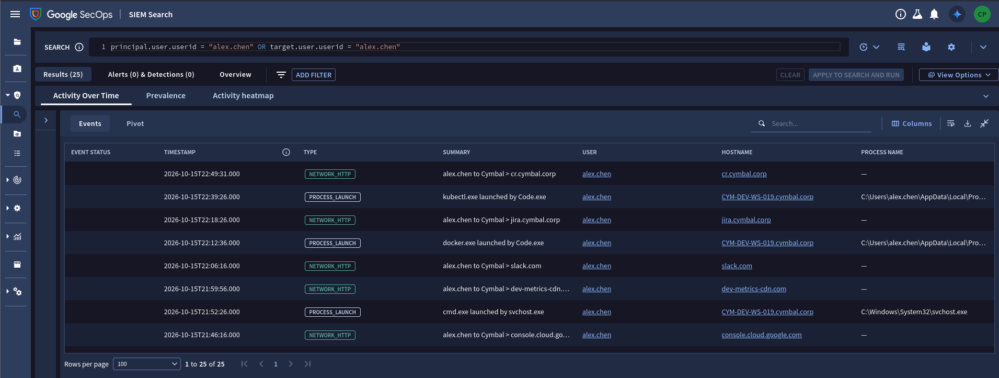

Second query:

```
principal.user.userid = "alex.chen" AND
(metadata.event_type = "NETWORK_HTTP" OR metadata.event_type = "FILE_CREATION" OR metadata.event_type = "NETWORK_CONNECTION")
```

One log looks suspicious. It uses a fake domain that only starts with the name of the real marketplace. This gives the second flag.

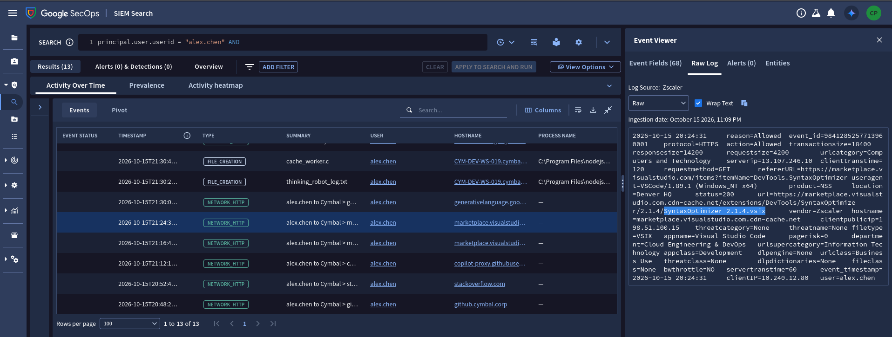

**Flag 2:** `SyntaxOptimizer-2.1.4.vsix`

### Q3. After the outbound API request, what compiled executable was dropped into the malware's staging folder?

*Expected format: `file_name.extension`*

In the previous logs, I saw a suspicious event at 21:30. But it was only `cache_worker.c`, which is C source code. The question asks for a **compiled executable**, so I searched for compiler process launches:

```
principal.hostname = /CYM-DEV-WS-019/ nocase AND
metadata.event_type = "PROCESS_LAUNCH" AND
target.process.command_line = /cache_worker|gcc|cl\.exe|tcc|clang|\.exe/ nocase
```

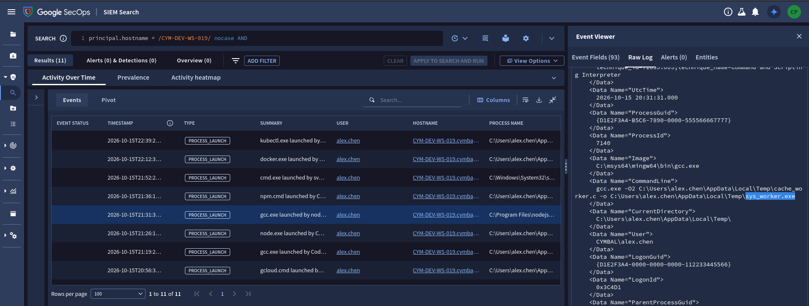

The event we need is at 21:31. Look for the command line that contains `gcc`. It shows the output executable, which is the flag.

**Flag 3:** `sys_worker.exe`

### Q4. What file in the user's cloud SDK config folder did the injected process read to steal tokens?

*Expected format: `file_name.extension`*

First, find the process that was hollowed:

```
principal.hostname = /CYM-DEV-WS-019/ nocase AND
(principal.process.file.full_path = /sys_worker/ nocase OR target.process.file.full_path = /sys_worker/ nocase)
```

The privileges go up from `alex.chen` to SYSTEM through `svchost.exe` with **PID 624**.

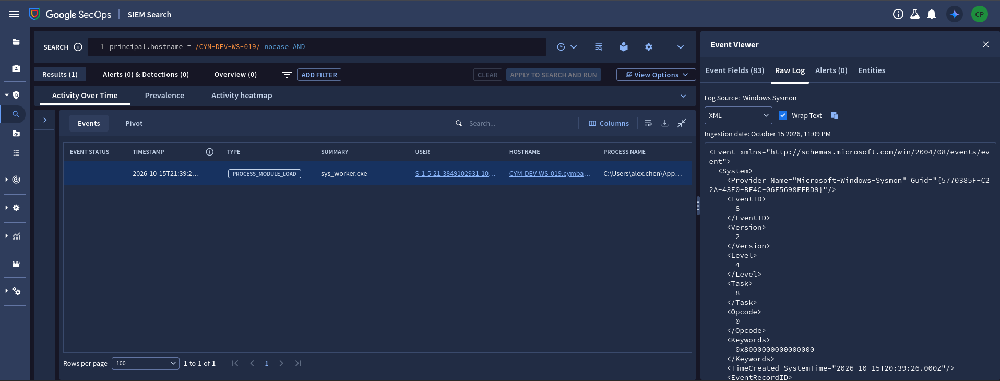

Next, search for activity from PID 624:

```
principal.hostname = /CYM-DEV-WS-019/ nocase AND
principal.process.pid = "624"
```

The log shows the injected process running `cmd.exe` to read alex.chen's gcloud credential database. That file is the flag.

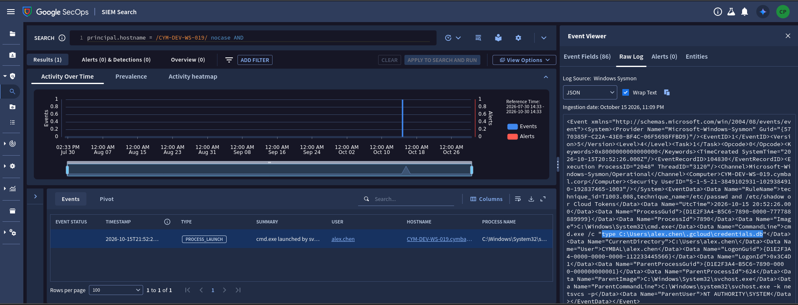

**Flag 4:** `credentials.db`

### Q5. To what external domain was the stolen data sent?

*Expected format: `domain-name.com`*

Shortly after the tokens were stolen (21:52:26), the data was sent with an HTTP POST to a path that pretends to be a telemetry endpoint. In alex.chen's timeline there is a strong candidate at 21:59:56.

Query:

```
principal.hostname = /CYM-DEV-WS-019/ nocase OR principal.ip = "10.240.12.80" OR principal.user.userid = "alex.chen"
```

This returns 28 logs. One of them is suspicious: `2026-10-15 21:59:56: alex.chen to Cymbal > dev-metrics-cdn.com`. It happened about 7 minutes after `credentials.db` was read, so it matches. The flag is in the hostname.

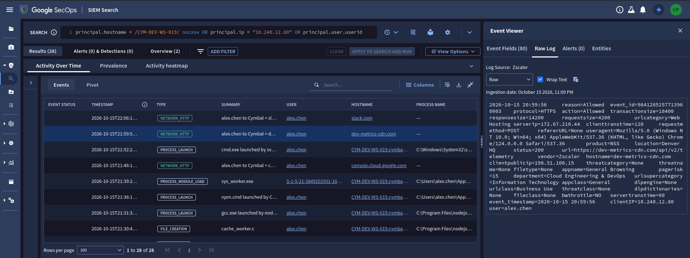

**Flag 5:** `dev-metrics-cdn.com`

### Q6. What PowerShell script did the attacker overwrite to keep persistence?

*Expected format: `file_name.extension`*

The attacker used the stolen service account to move from the developer's workstation to another server, `CYM-CI-RUNNER-01`. We need the `.ps1` file that was overwritten there. We can search for `.ps1` files directly:

```
principal.hostname = /CYM-CI-RUNNER-01/ nocase AND
target.file.full_path = /\.ps1$/ nocase
```

Only 1 log appears. It shows the `.ps1` file, which is the flag.

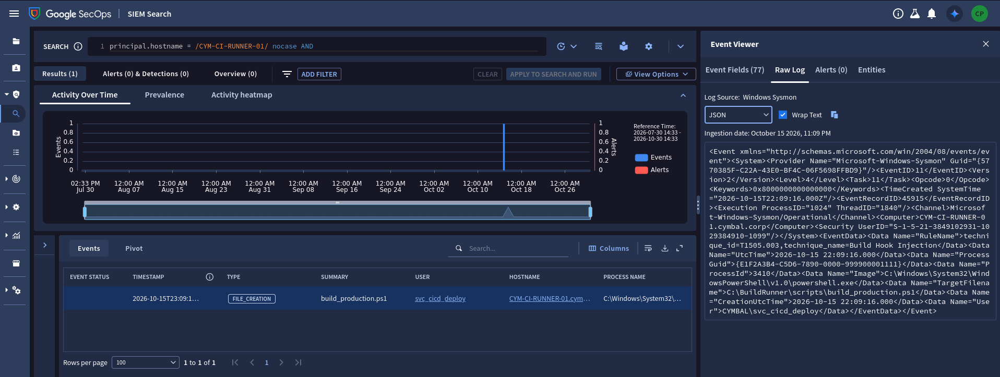

**Flag 6:** `build_production.ps1`

---

## Flag Summary

| Challenge | Question | Flag |
|---|---|---|
| Deceptive Click | Q1 | `CYM-DEN-W10-042.cymbal.corp` |
| Deceptive Click | Q2 | `marketingtrends-insider.com` |
| Deceptive Click | Q3 | `624` |
| Deceptive Click | Q4 | `MSSQLSvc/CYM-DB-01.cymbal.corp:1433` |
| Deceptive Click | Q5 | `svc_backup` |
| Deceptive Click | Q6 | `Financial_Audit_2025.zip` |
| OAuth Heist | Q1 | `sso-cymbal-portal.com` |
| OAuth Heist | Q2 | `Okta: A new MFA factor was added` |
| OAuth Heist | Q3 | `Cymbal_Q3_Database_Architecture_and_Service_Accounts.pdf` |
| OAuth Heist | Q4 | `svc_dbadmin` |
| OAuth Heist | Q5 | `cymbal_cust_q3.bak` |
| OAuth Heist | Q6 | `http://142.11.200.188:8888/upload/cymbal_q3_exfil.tar.zst` |
| Rogue Synthesis | Q1 | `alex.chen` |
| Rogue Synthesis | Q2 | `SyntaxOptimizer-2.1.4.vsix` |
| Rogue Synthesis | Q3 | `sys_worker.exe` |
| Rogue Synthesis | Q4 | `credentials.db` |
| Rogue Synthesis | Q5 | `dev-metrics-cdn.com` |
| Rogue Synthesis | Q6 | `build_production.ps1` |
